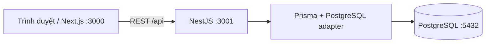

# Sơ đồ dự án

Baseline thiết kế cho issue #1:

- [ERD, ràng buộc/index và chủ bảng](erd.md)
- [Schema Prisma tham chiếu](schema.prisma)
- [Quy tắc nghiệp vụ và bảng chuyển trạng thái](../requirements/business-rules.md)

Schema runtime của khung API đã có 13 bảng nghiệp vụ theo schema tham chiếu và giữ SystemCheck. Áp dụng migration bằng prisma:deploy sau khi trưởng nhóm review/merge PR nền; service nghiệp vụ vẫn phải được từng thành viên thực hiện và kiểm thử.
