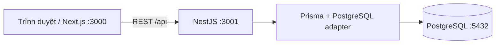

# Sơ đồ dự án

Baseline thiết kế cho issue #1:

- [ERD, ràng buộc/index và chủ bảng](erd.md)
- [Schema Prisma tham chiếu](schema.prisma)
- [Quy tắc nghiệp vụ và bảng chuyển trạng thái](../requirements/business-rules.md)

Schema runtime hiện tại chỉ có SystemCheck. TV3 phối hợp chủ module tạo PR migration nền theo schema tham chiếu sau review; tài liệu thiết kế không tự tạo bảng trong database.
