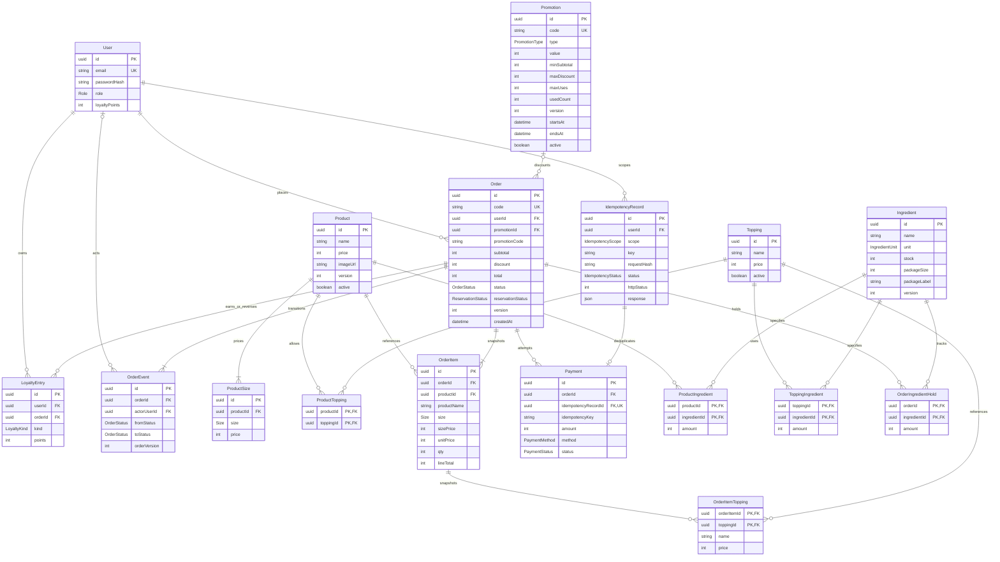

# ERD và quyền sở hữu schema — BrewLite v1

## Bổ sung Công thức & Tồn kho theo nguyên liệu ngày 27 tháng 10 năm 2026

Migration `20261027020000_ingredient_recipes` thêm các bảng `Ingredient` (nguyên liệu, đơn vị gốc, tồn kho, kích thước đóng gói), `ProductIngredient` (công thức món theo size S), `ToppingIngredient` (công thức 1 phần topping), `OrderIngredientHold` (giữ kho theo nguyên liệu cho đơn để hoàn kho). Mọi khóa ngoại dùng `onDelete: Restrict`. Ràng buộc DB CHECK: `Ingredient_stock_version_package` (`stock >= 0 AND version >= 0 AND packageSize > 0`), `ProductIngredient_amount` (`amount > 0`), `ToppingIngredient_amount` (`amount > 0`), `OrderIngredientHold_amount` (`amount > 0`).

Migration `20261027030000_drop_product_stock` bỏ cột `Product.stock` và cập nhật ràng buộc CHECK `Product_money_version` (`price BETWEEN 0 AND 2000000000 AND version >= 0`). Tồn kho sản phẩm và topping được tính toán theo nguyên liệu thay vì lưu trực tiếp ở bảng `Product`.
Đọc cùng [quy tắc nghiệp vụ](../requirements/business-rules.md) và [schema Prisma tham chiếu](schema.prisma). Bộ khung API đã đưa 13 bảng nghiệp vụ này vào schema runtime bằng migration nền `20261022010000_api_baseline`, giữ SystemCheck và migration cũ. Tại main ngày 26/10/2026, service nghiệp vụ đã tích hợp PostgreSQL; xem [nghiệm thu](../qa/final/README.md). Gateway thanh toán là mock theo MVP.

## Ràng buộc và index

| Nhóm | Quy định |
| --- | --- |
| ID | UUID; code đơn `BL-YYYYMMDD-XXXXXXXX` (ngày UTC, 8 ký tự hex uppercase), unique và retry khi trùng |
| Quan hệ | FK Restrict, không xóa cứng user/catalog/promotion đã có giao dịch; dùng active cho catalog/promo |
| Catalog | unique ProductSize(productId,size); PK ProductTopping(productId,toppingId); active catalog không thay snapshot cũ |
| Order | code unique; index (userId,createdAt,id), (status,createdAt); version mặc định 0, tăng mỗi transition |
| Idempotency | unique(userId,scope,key); response/status chỉ công khai qua replay đúng user, không expose requestHash |
| Payment | idempotencyRecordId unique; index orderId; SQL partial unique orderId khi status SUCCEEDED/REFUNDED để chặn hai thành công kể cả khác key; idempotencyKey phải bằng record.key |
| Loyalty | unique(orderId,kind) cho EARN/REVERSE; index(userId,createdAt,id); userId phải khớp chủ đơn |
| Audit | unique(orderId,orderVersion); sự kiện tạo có fromStatus=null, toStatus=PENDING, orderVersion=0 |
| Công thức & Nguyên liệu | PK ProductIngredient(productId,ingredientId); PK ToppingIngredient(toppingId,ingredientId); PK OrderIngredientHold(orderId,ingredientId); FK Restrict |
| DB CHECK trong migration | stock/version/price/counter/loyaltyPoints >=0; qty 1..99; subtotal,discount,total trong 0..2000000000; total=subtotal-discount; discount<=subtotal; Promotion endsAt>startsAt, maxUses null hoặc >0, usedCount<=maxUses nếu có; PERCENT.value 1..100, FIXED.value>0; Ingredient stock>=0, version>=0, packageSize>0; ProductIngredient, ToppingIngredient, OrderIngredientHold amount>0 |
| Ràng buộc dịch vụ | S price bằng Product.price; user của Payment/ledger theo chủ Order; reservationStatus tương ứng State Machine; maxDiscount chỉ PERCENT; canonical cart; EARN>=0 và REVERSE=-EARN; validate các giới hạn API |

Schema Prisma không biểu diễn tất cả CHECK hoặc ràng buộc nhiều bảng. Migration nền phải bổ sung các CHECK nêu trên; service thực thi các invariant liên bảng trong transaction. Không tuyên bố chỉ validate Prisma là đã bảo đảm nghiệp vụ đồng thời.

## Ai sửa bảng nào?

| Chủ trì | Bảng/module | Phối hợp |
| --- | --- | --- |
| TV1 | Product, ProductSize, Topping, ProductTopping, Promotion; seed catalog/mã | TV3 review trường stock/version/counter và transaction |
| TV2 | Cart frontend; không tạo bảng cart trong MVP | TV1 hợp đồng catalog, TV3/TV5 checkout |
| TV3 | Order, OrderItem, OrderItemTopping, OrderEvent; migration nền chung | Tất cả chủ bảng review baseline; sở hữu dịch vụ chuyển trạng thái |
| TV4 | User, LoyaltyEntry; JWT/loyalty | TV3/TV5 phối hợp cộng/đảo điểm trong transaction |
| TV5 | Payment, IdempotencyRecord | TV3 phối hợp unit-of-work và thứ tự khóa |
| Trưởng nhóm | Review và thứ tự merge schema/migration | Không tạo migration trùng chức năng ở nhiều nhánh |

Schema/migration nền đã được chuẩn bị trong PR khung API; TV3 cùng các chủ bảng review và kiểm chứng trước khi trưởng nhóm merge. Không tạo migration nền thứ hai trùng các bảng này. Sau khi merge, mọi thành viên cập nhật main rồi tạo migration bổ sung nếu cần. Không chỉnh migration đã áp dụng/đã merge; tạo migration mới. SystemCheck được giữ nguyên.
