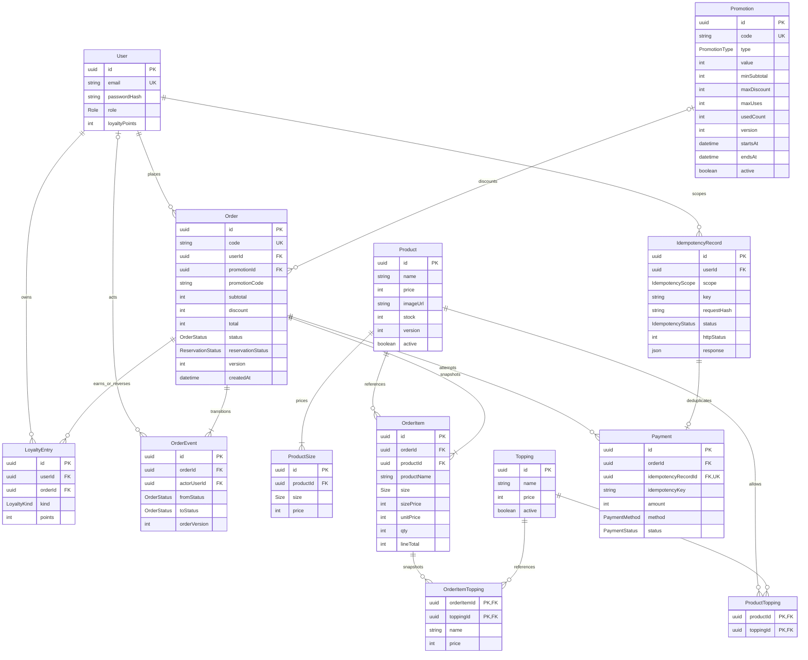

# ERD và quyền sở hữu schema — BrewLite v1

Đọc cùng [quy tắc nghiệp vụ](../requirements/business-rules.md) và [schema Prisma tham chiếu](schema.prisma). Chỉ có bảng SystemCheck đang tồn tại trong runtime; sơ đồ sau là thiết kế để triển khai tiếp.

## Ràng buộc và index

| Nhóm | Quy định |
| --- | --- |
| ID | UUID; code đơn `BL-YYYYMMDD-XXXXXXXX` (ngày UTC, 8 ký tự hex uppercase), unique và retry khi trùng |
| Quan hệ | FK Restrict, không xóa cứng user/catalog/promotion đã có giao dịch; dùng active cho catalog/promo |
| Catalog | unique ProductSize(productId,size); PK ProductTopping(productId,toppingId); active catalog không thay snapshot cũ |
| Order | code unique; index (userId,createdAt,id), (status,createdAt); version mặc định 0, tăng mỗi transition |
| Idempotency | unique(userId,scope,key); response/status chỉ công khai qua replay đúng user, không expose requestHash |
| Payment | idempotencyRecordId unique; index orderId; idempotencyKey nằm trên Payment để đáp ứng thực thể tối thiểu của đề, phải bằng record.key |
| Loyalty | unique(orderId,kind) cho EARN/REVERSE; index(userId,createdAt,id); userId phải khớp chủ đơn |
| Audit | unique(orderId,orderVersion); sự kiện tạo có fromStatus=null, toStatus=PENDING, orderVersion=0 |
| DB CHECK trong migration | stock/version/price/counter/loyaltyPoints >=0; qty 1..99; subtotal,discount,total trong 0..2000000000; total=subtotal-discount; discount<=subtotal; Promotion endsAt>startsAt, maxUses null hoặc >0, usedCount<=maxUses nếu có; PERCENT.value 1..100, FIXED.value>0 |
| Ràng buộc dịch vụ | S price bằng Product.price; user của Payment/ledger theo chủ Order; reservationStatus tương ứng State Machine; maxDiscount chỉ PERCENT; canonical cart; EARN>=0 và REVERSE=-EARN; validate các giới hạn API |

Schema Prisma không biểu diễn tất cả CHECK hoặc ràng buộc nhiều bảng. Migration nền phải bổ sung các CHECK nêu trên; service thực thi các invariant liên bảng trong transaction. Không tuyên bố chỉ validate Prisma là đã bảo đảm nghiệp vụ đồng thời.

## Ai sửa bảng nào?

| Chủ trì | Bảng/module | Phối hợp |
| --- | --- | --- |
| TV1 | Product, ProductSize, Topping, ProductTopping, Promotion; seed catalog/mã | TV3 review trường stock/version/counter và transaction |
| TV2 | Cart frontend; không tạo bảng cart trong MVP | TV1 hợp đồng catalog, TV3/TV5 checkout |
| TV3 | Order, OrderItem, OrderItemTopping, OrderEvent; migration nền chung | Tất cả chủ bảng review baseline; sở hữu dịch vụ chuyển trạng thái |
| TV4 | User, LoyaltyEntry; JWT/loyalty | TV3/TV5 phối hợp cộng/đảo điểm trong transaction |
| TV5 | Payment, IdempotencyRecord | TV3 phối hợp unit-of-work và thứ tự khóa |
| Trưởng nhóm | Review và thứ tự merge schema/migration | Không tạo migration trùng chức năng ở nhiều nhánh |

TV3 đưa schema baseline đã review vào backend/prisma/schema.prisma bằng một PR đầu tiên và tạo migration từ schema tham chiếu; giữ SystemCheck hoặc xóa nó bằng migration rõ ràng. Sau khi merge, mọi thành viên cập nhật main rồi tạo migration module bổ sung nếu cần. Không tự chỉnh migration đã áp dụng/đã merge; tạo migration mới. Feature branch có thể code theo schema tham chiếu trước nhưng phải cập nhật baseline trước khi merge.
